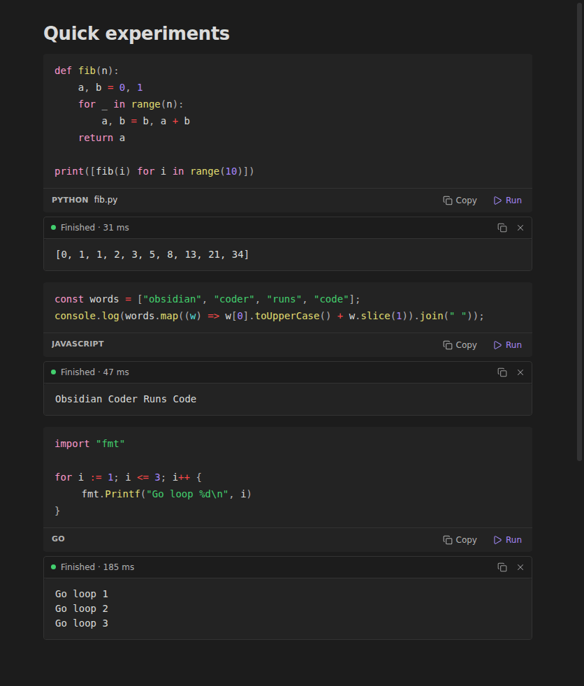
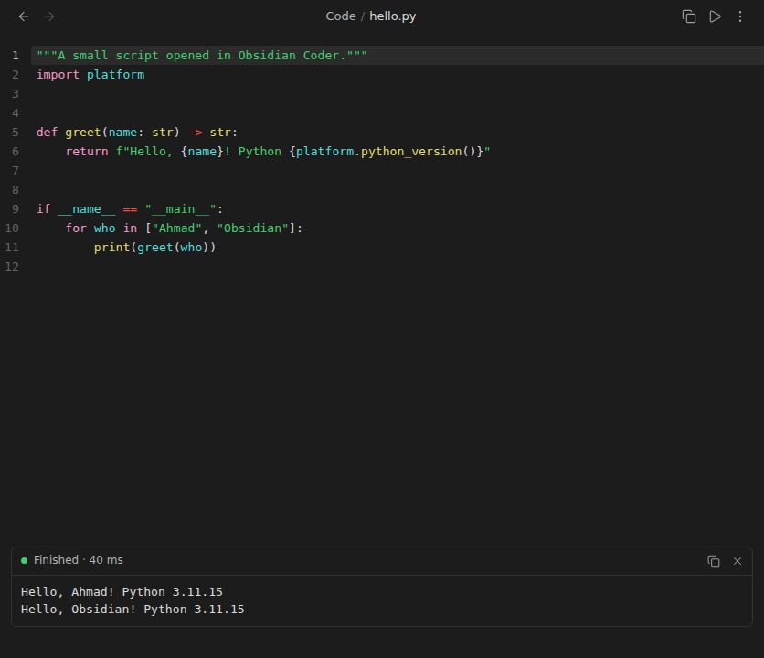
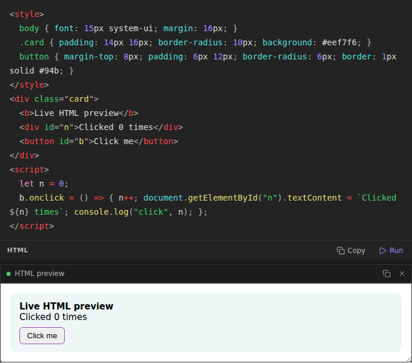
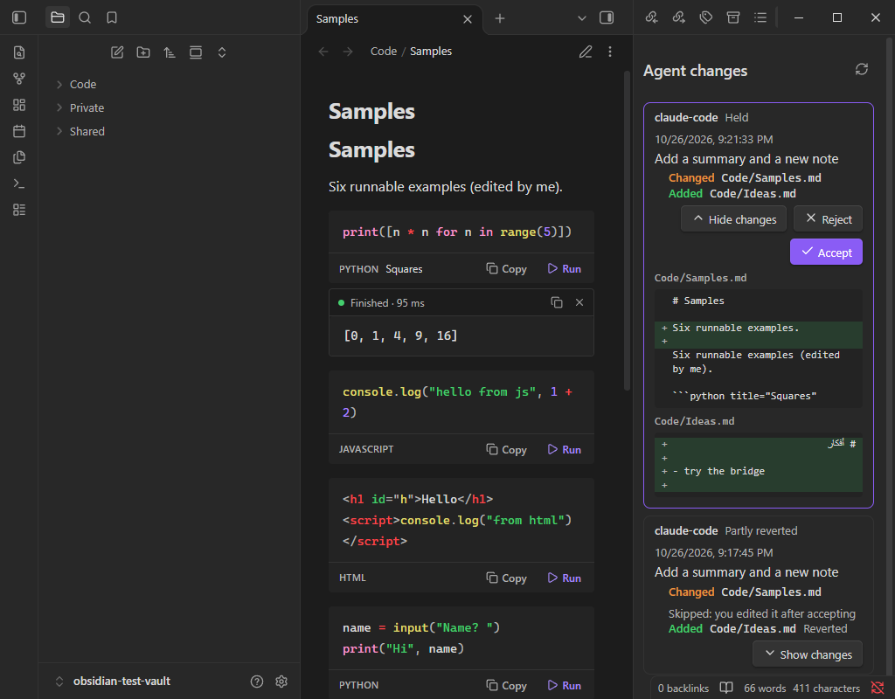
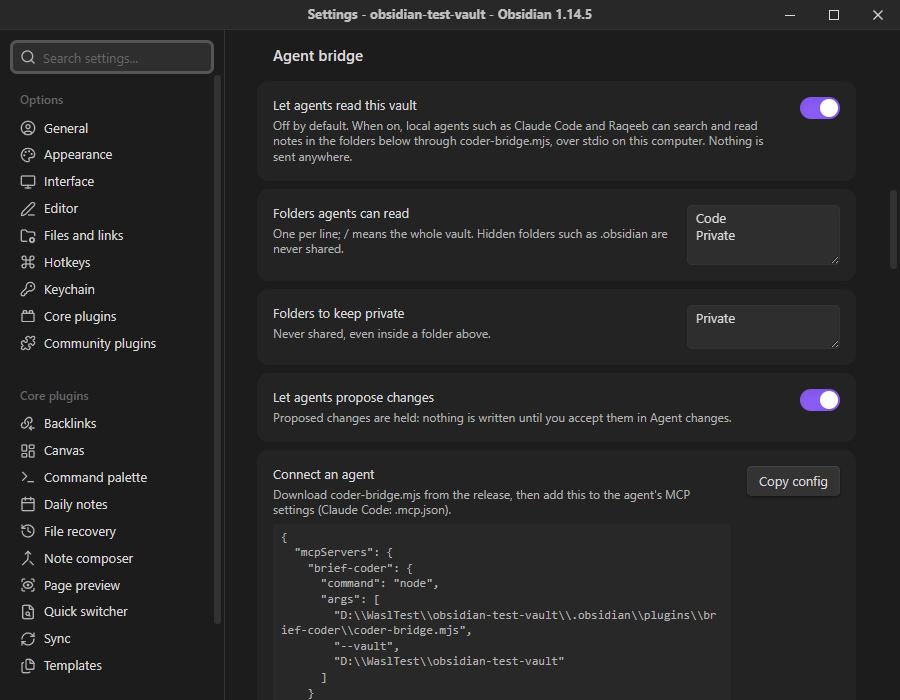

# Brief Coder

Run, view and edit code inside Obsidian. Every code block gets **Run** and **Copy**, output appears live under the block, and code files open in a real editor. It supports 40 languages, speaks English and Arabic, and stays light: under 100 KB, with nothing running until you press Run.

New in 1.1: **trusted folders** for notes from other people, an **Arabic interface**, and an opt-in **agent bridge** that lets local AI agents (Claude Code, Raqeeb) read the folders you choose and *propose* note changes that wait for your Accept.

> Brief Coder was called Obsidian Coder (plugin ID `coder-studio`) until 1.0.1. The community directory doesn't allow "Obsidian" in plugin names, so it was renamed, ID included. See [Moving from Obsidian Coder](#moving-from-obsidian-coder).



## What it does

- **Run and Copy on every code block**, in Reading view and Live Preview, including blocks inside lists and callouts.
- **Live output.**
  - Output streams in as the program prints.
  - Errors show in red, with the exit code and how long it took.
  - **Stop** ends long or stuck programs, along with anything they started.
  - Programs that ask for input (`input()`, `Scanner`, `read`) get a box to type into.
- **No boilerplate for snippets.** Go, Rust, Java, C, C++, Dart and PHP blocks run without `main`, a class or `<?php`; Brief Coder adds them for you.
- **HTML renders as a live preview**, and its `console.log` output appears with the rest.
- **Code files open in an editor.** `.py`, `.js`, `.ts`, `.go`, `.rs`, `.java`, `.c`, `.cs`, `.sh` and more get:
  - Syntax colours from your theme, line numbers, bracket matching, search and undo.
  - **Ctrl/Cmd + Enter** to run, with output below.
- **Safe with shared vaults.** Notes outside your trusted folders show their code and ask before running. Nothing ever runs on its own.
- **English and Arabic.** The interface follows Obsidian's language. Code always reads left to right, and each output line takes its own direction, so Arabic output reads right to left even in mixed text.
- **Works on phones and tablets.** JavaScript and HTML run inside Obsidian; other languages keep their Copy button.
- **Agent bridge (optional).** Local agents read only the folders you share, and any change they suggest is held for your review. See [Agent bridge](#agent-bridge).



## Languages

On desktop, Brief Coder uses the languages installed on your computer. **Settings → Brief Coder → Check** shows which ones it found.

| Group | Languages (code block names) |
| --- | --- |
| Built in, no install | JavaScript (`js`), HTML (`html`) |
| Scripting | Python (`python`, `py`), JavaScript with Node.js / Bun / Deno, TypeScript (`ts`), Shell (`bash`, `sh`), Zsh, Fish, PowerShell (`pwsh`), Batch (Windows), Ruby, PHP, Perl, Lua, R, Julia, AppleScript (macOS), SQL (`sql`, runs in a temporary SQLite database) |
| Compiled | Go, Rust, C, C++ (`cpp`), C# (`cs`), F#, Java, Kotlin, Scala, Groovy, Swift, Dart, Haskell, Elixir, Clojure, OCaml, Nim, Zig, Crystal, Racket, Common Lisp, Fortran, Octave / MATLAB |
| Copy only | CSS, JSON, YAML, TOML, XML, Dockerfile, Makefile, diff, LaTeX and about 70 more |

Blocks that Obsidian or other plugins render, such as `mermaid`, `dataview`, `tasks` and `query`, are left untouched.

## Install

Brief Coder needs Obsidian 1.8.7 or newer.

**With BRAT (until it's in the community directory)**

1. Install **BRAT** from Settings → Community plugins.
2. Run **BRAT: Add a beta plugin** and enter `Ahmad-AlModhayan/obsidian-coder`.
3. Enable **Brief Coder** in Settings → Community plugins.

**Manually**

1. Download `main.js`, `manifest.json` and `styles.css` from the [latest release](https://github.com/Ahmad-AlModhayan/obsidian-coder/releases/latest).
2. Put them in `<your vault>/.obsidian/plugins/brief-coder/`.
3. Reload Obsidian and enable **Brief Coder**.

### Moving from Obsidian Coder

The plugin ID changed from `coder-studio` to `brief-coder`, so Obsidian treats Brief Coder as a new plugin:

1. Install Brief Coder as above. On first start it imports your settings from `coder-studio` and says so.
2. Disable and remove **Obsidian Coder** (`coder-studio`) in Settings → Community plugins. With BRAT, also remove the old entry from BRAT's list, so it doesn't reinstall it.

## Using it

### Code blocks

````markdown
```python title="Squares"
print([n * n for n in range(5)])
```
````

- `title="…"` shows a name in the block's bar.
- `norun` keeps the Copy button but hides Run, for example ```` ```python norun ````.
- Output stays when you switch between Live Preview and Reading view. Clear it with **×**, or with **Clear all outputs in this note**.
- Code blocks run in the note's folder, so `open("data.csv")` reads a file next to the note. Settings can switch this to a temporary folder.

### Trusted folders

By default the whole vault is trusted (`/`), and code runs when you press Run, as in earlier versions. If your vault holds notes from other people (a shared or synced folder, an imported vault), list only your own folders in **Settings → Brief Coder → Trusted folders**. Code in any other note then shows the code and asks first. **Run all code blocks in this note** always asks once, and names what will run. **Ask before running** makes every run ask, wherever the note is.

### Code files

- Code files open straight from the file list.
- To make one, run **Create new code file** and type a name such as `scratch.py` or `tools/convert.js`.
- Edits save automatically, like notes. **Ctrl/Cmd + Enter**, or ▷ in the tab header, runs the file in place.

### HTML



HTML blocks and `.html` files render in a sandboxed frame that grows to fit the page. Drag its bottom edge to resize it.

### Commands

- Run code block at cursor
- Run all code blocks in this note
- Copy code block at cursor
- Clear all outputs in this note
- Stop all running code
- Create new code file
- Run current code file
- Review agent changes

Assign hotkeys to any of them in Settings → Hotkeys.

## Agent bridge

The agent bridge gives local AI agents your notes as context without giving them your vault. It is **off by default**. Full design: [docs/AGENT_BRIDGE.md](docs/AGENT_BRIDGE.md).



- **Read only what you share.** Agents see the folders you list, never hidden folders such as `.obsidian`, and never the folders you mark private.
- **Proposals are held.** An agent can propose new notes, edits and deletions. Nothing is written until you press **Accept** in **Agent changes**, which shows each change as a diff. **Reject** discards it. **Revert** undoes an accepted change.
- **You win.** Accept skips a note that changed since the proposal, and Revert skips a note you edited after accepting.
- **Local.** The bridge is `coder-bridge.mjs`, a small MCP server the agent starts on your computer. It talks over stdin/stdout: no port, no network, no account.

Set it up:

1. **Settings → Brief Coder → Agent bridge → Let agents read this vault.** Choose the folders to share and the ones to keep private.
2. Download `coder-bridge.mjs` from the [latest release](https://github.com/Ahmad-AlModhayan/obsidian-coder/releases/latest) into `<vault>/.obsidian/plugins/brief-coder/`. It needs Node.js 18 or newer.
3. Press **Copy config** in settings and add it to the agent's MCP settings. For Claude Code, put it in `.mcp.json`.

Agents get six tools: `list_notes`, `search_notes` (Arabic-aware), `read_note`, `list_code_blocks`, `propose_change` and `list_changes`. The bridge never runs code.

## Settings



| Setting | What it does |
| --- | --- |
| Show Run and Copy bar | Turns the bar under code blocks on or off. |
| Hide Obsidian's copy button | Avoids two copy buttons on one block. |
| Click inline code to copy | In Reading view, clicking `inline code` copies it. |
| Trusted folders | Notes in these folders run on click; others show the code and ask. `/` is the whole vault. |
| Ask before running | Asks before every run, wherever the note is. |
| Time limit | Stops programs after this many seconds. 0 means no limit. |
| Output kept per run | Keeps the newest output (200 KB by default), so endless printing can't slow Obsidian. |
| JavaScript runs with | Auto (Node.js if installed), Node.js, or the in-app sandbox. |
| Code files | Which extensions open in Brief Coder's editor, plus line numbers, wrapping and tab size. |
| Agent bridge | Off by default. Shared folders, private folders, whether agents may propose changes, and the config to copy. |
| Languages | Per-language command, e.g. `/opt/homebrew/bin/python3.12` or `py -3.12`. |

## Safety and disclosures

- **Code runs on your computer with your permissions**, the same as running it in a terminal. Only run code you trust, and use trusted folders if your vault contains notes from other people.
- **Nothing runs on its own.** Opening, syncing or rendering a note never runs its code.
- **Files outside the vault:** to run code, Brief Coder writes the block to a temporary folder in your system's temp directory and starts the installed interpreter or compiler there. Temporary folders are removed after each run. Build caches for C#, Scala, Nim and Crystal are kept per block and removed after 14 days unused.
- **Network:** Brief Coder itself makes no network requests and collects nothing. Code you run can use the network, like any program you run yourself. HTML previews run in a sandboxed frame with no access to Obsidian or your files.
- The **in-app JavaScript sandbox** runs like JavaScript in a browser tab: it has no access to your files, your vault or Obsidian.
- The **agent bridge** is off by default, runs only when an agent you configured starts it, and writes nothing to your notes until you accept a change. Any program running as you can still edit your files directly; the bridge narrows what a well-behaved agent does, it isn't a sandbox.

## Performance

Brief Coder was built to keep Obsidian fast. Measured in Obsidian 1.13 and 1.14:

- **Small:** about 98 KB, with no bundled libraries; CI fails a build over 100 KiB. The code editor and syntax colours reuse what Obsidian already ships. The Arabic interface is about 13 KB of that.
- **Quick to load:** its own startup work is a few milliseconds.
  - Desktop-only modules load the first time you press Run.
  - File types are registered in one step, so the file list refreshes once instead of 70 times.
- **Cheap in notes:**
  - A note is parsed once, however many code blocks it has. While you type, only the code block you're in is read again.
  - In Live Preview, bars are drawn only for blocks on screen.
  - Output panels are created only after a block runs, and HTML previews load only when they come on screen.
  - Typing costs about 0.06 ms per keystroke in ordinary text, and about 0.6 ms inside a code block of a 3,000-line note.
- **Idle means idle:** no timers or file watchers run while nothing is running, and memory doesn't grow as you open notes and code files. New agent proposals are checked when you come back to Obsidian.
- **Never blocks Obsidian:**
  - Programs run in their own process; JavaScript in a background worker; HTML previews in a separate sandboxed frame.
  - Obsidian stayed above 60 frames per second while a program printed endlessly (6.8 million characters in 4 seconds). Output is drawn incrementally in small pages, and pages scrolled out of view aren't drawn at all.
  - Stop works at once, even while a program is still starting, and also ends anything the program started.
- **Faster re-runs:** an unchanged C#, Scala, Nim or Crystal block reuses its build cache, so C# re-runs take about 0.3 s instead of several seconds.

## Troubleshooting

- **"… isn't installed, or Obsidian can't find it"**: install the language, or enter its full path in Settings → Brief Coder → Languages. On macOS and Linux, Brief Coder reads your shell's PATH, so tools from Homebrew, pyenv, nvm, cargo and similar are found automatically.
- **C#** files run with **.NET 10 or newer** (`dotnet run app.cs`). On older .NET, install `dotnet-script` and set it as the C# command.
- **Java** files run directly with **Java 11 or newer**.
- **TypeScript** needs one of `tsx`, Bun, Deno or Node.js 22.6+.
- **Windows:** Python runs through the `py` launcher, and `bash` blocks use Git Bash. A background job started with `&` in a Git Bash block keeps running after Stop; end it from the Task Manager, or don't start background jobs in blocks.
- **The agent bridge says it's off:** turn on **Let agents read this vault** in settings. The bridge reads the setting on every request, so no restart is needed.

## Development

```bash
npm install
npm run dev     # rebuilds main.js on change
npm run build   # type-check + production build
npm test        # unit tests + runs real snippets in every language installed on the machine
```

- `src/languages.ts`: the language table (names, file types, commands, snippet helpers).
- `src/run/`: desktop process runner, in-app runners, output buffer and run sessions.
- `src/ui/`: code-block bar (Reading view and Live Preview), output panel, code file editor, settings, Agent changes view.
- `src/agent/changes.ts`: held changesets (accept, reject, revert, diff).
- `src/i18n.ts`: English and Arabic interface text. A test fails if a string has no Arabic.
- `bridge/coder-bridge.mjs`: the agent bridge (MCP over stdio, no dependencies).

The test suite runs snippets in 32 languages end to end, and also covers Stop, the time limit, typed input, output limits, temporary-file cleanup, error messages, the bridge's scope rules, and accepting and reverting changesets. [docs/TESTING.md](docs/TESTING.md) records the last run inside Obsidian.

**Releasing:** run `npm version patch` (or `minor` / `major`), update `.github/RELEASE_NOTES.md`, and push to `main`. GitHub Actions builds, tests and publishes the release with `main.js`, `manifest.json`, `styles.css` and `coder-bridge.mjs`.

## License

[MIT](LICENSE) © Ahmad AlModhayan
